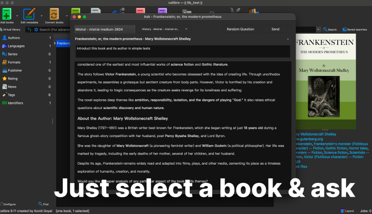

# Ask AI Plugin (previously Ask Grok)

A calibre plugin for asking questions about books in your library. It works after install with **Nvidia AI (Free)** (no API key). Add your own providers when you want.

## Preview

## Features

- Ask about one book or several selected books, without copy-pasting metadata
- Works out of the box with Nvidia AI (Free)
- Search the library in natural language (AI Search)
- Read an EPUB and ask about selected text
- Random questions, prompt templates, and recent history per book
- Copy an answer, or copy the question and answer together

## Installation

### From the calibre Plugin Index

1. In calibre, open Preferences → Plugins → Get new plugins
2. Search for "Ask AI Plugin"
3. Install it and restart calibre

### From a release file

Download the latest zip from the [releases page](https://github.com/sheldonrrr/ask_grok/releases), then:

1. Preferences → Plugins → Load plugin from file
2. Choose the zip and restart calibre

## Supported AI Providers

- **OpenAI** — https://platform.openai.com/
- **Anthropic (Claude)** — https://console.anthropic.com/
- **Google Gemini** — https://aistudio.google.com/
- **Grok (SpaceXSI)** — https://console.x.ai/
- **DeepSeek** — https://platform.deepseek.com/
- **Kimi (Moonshot)** — https://platform.kimi.ai/ (China: https://platform.moonshot.cn/)
- **Mistral** — https://console.mistral.ai/
- **Nvidia AI (Free)** — default. No API key. A shared channel for people who have not set up their own AI. It can be less stable than your own key.
- **Nvidia AI** — https://build.nvidia.com/ (your own key; new accounts usually get free credits)
- **Perplexity (Sonar)** — https://docs.perplexity.ai/ (answers can include a citation list)
- **OpenRouter** — https://openrouter.ai/
- **Ollama** — https://ollama.com/ (local)
- **LM Studio** — https://lmstudio.ai/ (local)
- **KoboldCpp** — https://github.com/LostRuins/koboldcpp (local)
- **Custom (OpenAI Compatible)** — any Chat Completions API (`/chat/completions`)

**Nvidia AI (Free)** and **Nvidia AI** are separate providers. The free one needs no signup. Default model: `nvidia/nemotron-3.5-lightning-30b-a3b`. Your own key talks to Nvidia directly (`https://integrate.api.nvidia.com/v1`). Default model: `nvidia/nemotron-3-nano-30b-a3b`.

## Configure an AI

Nvidia AI (Free) needs no setup. For another provider: open the plugin menu, choose **Configure**, click **Add AI**, enter a key if required, pick a model, and save. Local providers usually do not need a key.

## Use

1. Select a book
2. Click **Ask AI Plugin** in the toolbar
3. Type a question and click **Send**
4. **Random Question** asks for questions in your selected language

## Keyboard Shortcuts

Change these in Preferences → Shortcuts. Search for "Ask AI".

- Ask: Ctrl+L
- Read and ask: Ctrl+Shift+V (Cmd+Shift+V on macOS)
- Configuration: F2
- Send (in the dialog): Ctrl+Enter (Cmd+Enter on macOS)
- Random Question (in the dialog): Ctrl+Shift+R (Cmd+Shift+R on macOS)

## Languages

English, German, Spanish, French, Japanese, Simplified Chinese, Traditional Chinese, Danish, Finnish, Dutch, Norwegian, Portuguese, Russian, Swedish, and Cantonese.

## Requirements

- calibre 6.0 or newer
- No extra Python packages; libraries ship inside the plugin

## Privacy

- API keys stay in calibre’s local plugin settings. They are not sent to the plugin author.
- Your question and the selected book’s metadata go to the AI provider you are using.
- **Nvidia AI (Free)** goes through a developer-maintained channel, then Nvidia. To keep questions on an account you control, use your own key or a local provider.
- Other providers follow their own privacy policies.

## Troubleshooting

If requests keep failing, remove the plugin’s local files, install the latest version, and restart calibre.

1. Preferences → Miscellaneous → Open calibre configuration folder → Plugins
2. Delete entries whose names start with `ask_ai_plugin`, and the Ask AI Plugin folder
3. Install the latest plugin and restart calibre

When you report a problem, leave your API key out of the message.
